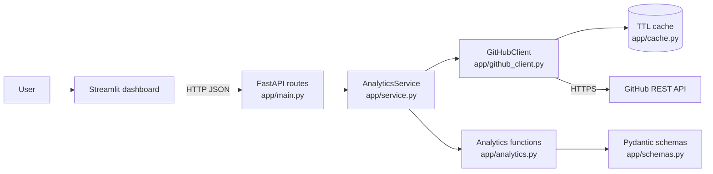

# GitHub Profile Analytics


A Python web app that turns any public GitHub username into an analytics dashboard: profile summary, star and fork totals, language charts, a searchable repository table, and CSV/JSON exports. Every number is calculated live from the official GitHub REST API.

## Project overview

The project has two parts that run as separate processes:

- **Backend** (FastAPI): talks to GitHub, handles pagination, rate limits, retries and caching, calculates the analytics and serves them as a documented JSON API.
- **Dashboard** (Streamlit + Plotly + Pandas): calls the backend and shows the results.

## Problem statement

GitHub shows a profile's repositories one by one, but it does not summarize them. Questions such as "which languages does this person use most?", "which projects get the most stars?" or "what changed recently?" need manual counting. This tool answers them in one view and makes the data downloadable.

## Project objectives

- Integrate with a real REST API: pagination, errors, rate limits, retries, caching.
- Keep API access, analytics and UI in separate modules.
- Report data honestly, including what is partial or unavailable.
- Be fully tested without network access (all GitHub responses are mocked).

## Features

- Profile overview with graceful fallbacks for missing fields.
- Repository analytics: total/average stars, total forks, most-starred and most-forked, rankings, recent updates.
- Language analysis in two views: by repository count (primary language) and by code bytes (from `GET /repos/{owner}/{repo}/languages`).
- Recent activity: recently pushed repositories plus a summary of GitHub's public events feed, labelled with its limits.
- Search by name, filter by language, sort by stars / forks / recently updated, hide archived or forked repositories.
- CSV export (one row per analyzed repository) and JSON export (profile, analytics, list of analyzed repositories).
- Handles invalid usernames, unknown users, rate limits, timeouts and GitHub outages with clear messages.
- Works without a token (60 requests/hour). An optional token raises the limit to 5,000/hour.

## Technology stack

| Area | Tools |
| --- | --- |
| Backend | Python 3.11+, FastAPI, Uvicorn, HTTPX, Pydantic, python-dotenv |
| Dashboard | Streamlit, Plotly, Pandas |
| Quality | Pytest, Ruff, Git |
| Data source | [GitHub REST API](https://docs.github.com/en/rest) |

## Architecture and data flow



1. The user enters a username. The dashboard calls `/analytics`, `/repositories`, `/activity` and two `/export` endpoints.
2. The service validates the username, fetches the profile and all repository pages, then fetches language bytes for up to 30 repositories (in parallel).
3. Pure functions in `analytics.py` calculate totals, rankings and language statistics.
4. The dashboard draws the charts and tables from the JSON it received.

Business logic never lives in the routes, and the dashboard never calls GitHub directly.

## Folder structure

```text
github-profile-analytics/
├── app/
│   ├── main.py            # FastAPI routes and error handlers
│   ├── service.py         # Orchestrates client + analytics
│   ├── github_client.py   # GitHub API client (pagination, retries, rate limits)
│   ├── analytics.py       # Pure calculation and export functions
│   ├── schemas.py         # Pydantic response models
│   ├── config.py          # Settings from environment variables
│   ├── cache.py           # In-memory TTL cache
│   └── exceptions.py      # Application errors with HTTP status codes
├── dashboard/streamlit_app.py
├── tests/                 # 73 tests, no network needed
├── screenshots/           # Add your own screenshots here
├── .streamlit/config.toml # Dashboard theme
├── .env.example
├── requirements.txt       # Runtime dependencies
├── requirements-dev.txt   # Runtime + pytest + ruff
└── pyproject.toml         # Ruff and pytest settings
```

`service.py` is the one file added beyond the suggested layout. It keeps routes thin.

## Prerequisites

- Windows 10/11 with [Python 3.11 or newer](https://www.python.org/downloads/) (tick "Add Python to PATH" during install).
- [VS Code](https://code.visualstudio.com/) with the Python extension.
- [Git](https://git-scm.com/download/win).

## Installation (VS Code + PowerShell)

Open the project folder in VS Code, then open a terminal (`Terminal > New Terminal`).

```powershell
python -m venv .venv
.\.venv\Scripts\Activate.ps1
python -m pip install --upgrade pip
python -m pip install -r requirements-dev.txt
```

If PowerShell refuses to run `Activate.ps1`, run this once and retry:

```powershell
Set-ExecutionPolicy -Scope CurrentUser -ExecutionPolicy RemoteSigned
```

In VS Code, press `Ctrl+Shift+P`, choose **Python: Select Interpreter**, and pick the `.venv` one.

## Environment variables

```powershell
Copy-Item .env.example .env
```

| Variable | Default | Purpose |
| --- | --- | --- |
| `GITHUB_TOKEN` | empty | Optional. Raises the rate limit from 60 to 5,000 requests/hour. |
| `GITHUB_API_URL` | `https://api.github.com` | Change only for testing. |
| `REQUEST_TIMEOUT_SECONDS` | `10` | Timeout for every GitHub request. |
| `MAX_RETRIES` | `2` | Retries for transient errors only. |
| `CACHE_TTL_SECONDS` | `300` | How long GitHub responses are cached. |
| `LANGUAGE_REPO_LIMIT` | `30` | Max repositories whose language bytes are fetched. |
| `LOG_LEVEL` | `INFO` | Python logging level. |
| `BACKEND_URL` | `http://127.0.0.1:8000` | Where the dashboard finds the backend. |

**Using a token safely.** Create a token at GitHub > Settings > Developer settings > Personal access tokens. A token with **no scopes** is enough, because only public data is read. Paste it into `.env` after `GITHUB_TOKEN=`. The `.env` file is in `.gitignore`. Never put a token in `.env.example`, in code, or in a screenshot. The app never logs or returns it.

## Running the app

Use two terminals, both with the virtual environment activated.

**Terminal 1: backend**

```powershell
python -m uvicorn app.main:app --reload
```

**Terminal 2: dashboard**

```powershell
python -m streamlit run dashboard/streamlit_app.py
```

| What | URL |
| --- | --- |
| Dashboard | http://localhost:8501 |
| API | http://127.0.0.1:8000 |
| Swagger docs | http://127.0.0.1:8000/docs |

To point the dashboard at a different backend, set `BACKEND_URL` in `.env` (or the environment) and restart Streamlit.

## API endpoints

| Method | Path | Description |
| --- | --- | --- |
| GET | `/api/health` | Status, version, whether a token is configured, last seen GitHub rate-limit values. |
| GET | `/api/profile/{username}` | Public profile. |
| GET | `/api/profile/{username}/repositories?page=1&per_page=100` | Owned public repositories. `per_page` up to 1000. |
| GET | `/api/profile/{username}/analytics?include_forks=true` | Totals, rankings, language statistics, notes. |
| GET | `/api/profile/{username}/activity` | Summary of the public events feed. |
| GET | `/api/profile/{username}/export?format=csv\|json` | File download. |

Errors always have the same shape:

```json
{ "error": { "code": "user_not_found", "message": "GitHub user 'x' was not found.", "details": {} } }
```

| Situation | Status | `code` |
| --- | --- | --- |
| Invalid username | 400 | `invalid_username` |
| User not found | 404 | `user_not_found` |
| Bad query parameter | 422 | `validation_error` |
| GitHub rate limit | 429 (with `Retry-After` when known) | `rate_limited` |
| GitHub error / bad token / malformed data | 502 | `github_error`, `github_auth_failed`, `malformed_response` |
| GitHub timeout | 504 | `github_timeout` |
| Unexpected bug | 500 (no internals exposed) | `internal_error` |

## Example usage

```powershell
curl "http://127.0.0.1:8000/api/profile/octocat/analytics"
curl -OJ "http://127.0.0.1:8000/api/profile/octocat/export?format=csv"
```

**Example response shape (trimmed, with made-up values for illustration only):**

```json
{
  "username": "example-user",
  "summary": {
    "public_repo_count": 42,
    "analyzed_repo_count": 42,
    "total_stars": 1011,
    "total_forks": 154,
    "average_stars": 24.07,
    "most_starred": { "name": "project-a", "url": "https://github.com/example-user/project-a", "value": 140 },
    "most_used_language": "Python"
  },
  "primary_languages": [{ "language": "Python", "repo_count": 8, "repo_percent": 25.0 }],
  "language_bytes": [{ "language": "Python", "bytes": 52000, "bytes_percent": 41.5 }],
  "language_coverage": { "repositories_considered": 42, "repositories_with_data": 30, "limit": 30, "complete": false }
}
```

## Screenshots

Screenshots are not included yet. After you run the app, save images into `screenshots/` and add them here:

```markdown


```

## Testing

```powershell
python -m pytest
python -m ruff check .
python -m ruff format --check .
```

The suite has 73 tests. All GitHub responses are mocked with `httpx.MockTransport`, so tests need no internet or token. They cover username validation, user not found, empty repository lists, pagination, multiple languages, star/fork totals, most-starred selection, missing description/language, rate limits, timeouts, retries, caching, error response format, and CSV/JSON export correctness.

## Rate-limit and data-accuracy limitations

- **Rate limits.** Without a token GitHub allows 60 requests/hour per IP. One analysis uses about 5 to 40 requests (profile, repository pages, one language call per measured repository, events). If the limit is hit, repository statistics still work and the language bytes are marked partial. Add a token for more headroom.
- **Public vs analyzed.** The profile's public repository count and the number of repositories analyzed can differ (for example with "Include forked repositories" unchecked). Both are always shown.
- **Language bytes cover at most 30 repositories**, the most-starred ones, to protect the rate limit. The UI shows how many were measured.
- **Two language views mean different things.** Repository count gives each repository to one primary language. Code bytes measure volume of code, and large or generated files can dominate it. Neither measures skill.
- **Activity is not contributions.** The events feed covers only recent public events (about 300 events / 90 days). A repository's "updated" date can change for reasons other than new code. The contribution graph is not available through the REST API, so it is not shown.
- **Open issues** is GitHub's `open_issues_count`, which includes open pull requests.
- Results are cached for 5 minutes, so very recent changes may not appear immediately.

## Security considerations

- The token lives only in `.env` (git-ignored) or hosting secrets, and is sent only in the Authorization header.
- Usernames are validated against GitHub's rules and URL-encoded before use.
- Every outbound request has a timeout. Retries are bounded and only used for transient errors.
- All text from GitHub is HTML-escaped before the dashboard renders it.
- CSV cells that start with `=`, `+`, `-` or `@` are prefixed with `'` so spreadsheets do not run them as formulas.
- Unexpected errors return a generic message. Details go only to the server log.

## Deployment

I have not deployed this project, so no live URL is listed. These steps are untested on the hosting platforms. The configuration itself was verified locally.

**Backend (for example Render or Railway, any host that runs Python web services)**

- Build command: `pip install -r requirements.txt`
- Start command: `python -m uvicorn app.main:app --host 0.0.0.0 --port $PORT`
- Environment variables: `GITHUB_TOKEN` (optional, set in the host's secrets UI, never in the repository).
- Check `https://<your-backend>/api/health` and `/docs`.

**Dashboard (Streamlit Community Cloud)**

1. Push the repository to GitHub, then create an app at https://share.streamlit.io.
2. Main file path: `dashboard/streamlit_app.py`. The platform installs `requirements.txt`.
3. In **Advanced settings > Secrets**, add:

   ```toml
   BACKEND_URL = "https://<your-backend>"
   ```

4. Deploy the backend first, because the dashboard needs its URL. Free tiers may sleep, so the first request can be slow.

The dashboard calls the backend from its own server, so browser CORS settings are not needed.

## Git and GitHub

```powershell
git init
git add .
git status          # confirm .env is NOT listed
git commit -m "Initial commit: GitHub Profile Analytics"
git branch -M main
git remote add origin https://github.com/<your-username>/github-profile-analytics.git
git push -u origin main
```

Create the empty repository on GitHub first (no README, no .gitignore). After that, prefer small commits, for example one per feature or fix.

- **Suggested description:** Python dashboard and REST API that analyze any public GitHub profile: repositories, languages, stars, forks and exports.
- **Suggested topics:** `python`, `fastapi`, `streamlit`, `plotly`, `pandas`, `github-api`, `data-analytics`, `dashboard`, `rest-api`, `pytest`
- After running the app, add screenshots to `screenshots/` and commit them.

## Future enhancements

The modules are separated so these can be added without rewrites: historical snapshots (SQLite/PostgreSQL behind the service layer), comparing several profiles, scheduled reports, deeper commit analysis, PDF reports, Docker, GitHub Actions CI, and a public API deployment.

## License

MIT. See [LICENSE](LICENSE). Replace `YOUR NAME` in the license file.

## Author

**YOUR NAME**: [github.com/YOUR-USERNAME](https://github.com/YOUR-USERNAME)

---

Data from the GitHub REST API. This project is not affiliated with or endorsed by GitHub.
